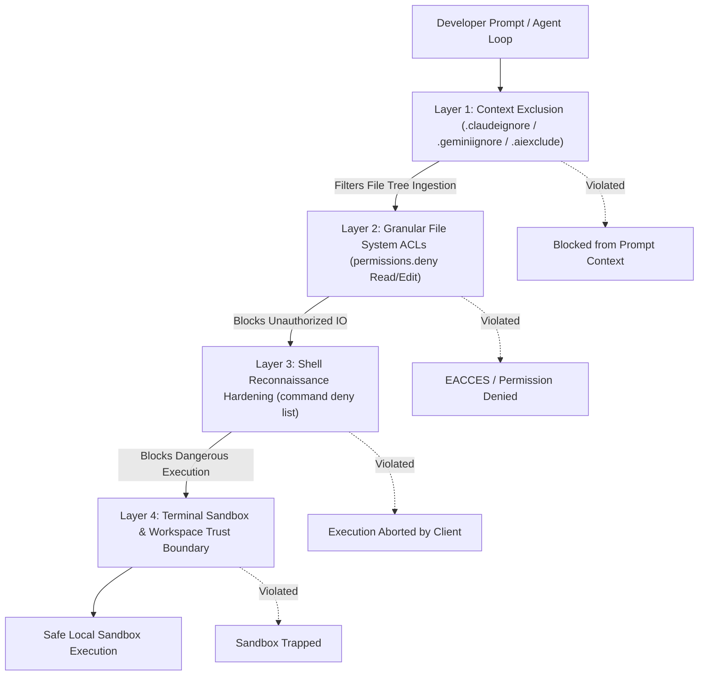

# AI CLI Privacy & Data Sovereignty Configuration (macOS)

[-black.svg?style=flat-square&logo=apple)](https://www.apple.com/macos/)
[](https://docs.anthropic.com/)
[](https://csrc.nist.gov/glossary/term/defense_in_depth)
[](LICENSE)

An enterprise-grade, defense-in-depth privacy and data governance framework for agentic AI command-line interfaces (**Anthropic Claude Code** and **Google Antigravity CLI**) on **macOS**.

---

## Table of Contents

- [Overview & Problem Statement](#overview--problem-statement)
- [Threat Model & Defense-in-Depth Architecture](#threat-model--defense-in-depth-architecture)
- [Repository Structure](#repository-structure)
- [Core Protection Layers](#core-protection-layers)
  - [1. Ingestion & Context Exclusion Rules](#1-ingestion--context-exclusion-rules)
  - [2. File System Access Control Lists (ACLs)](#2-file-system-access-control-lists-acls)
  - [3. Shell Execution & Reconnaissance Mitigation](#3-shell-execution--reconnaissance-mitigation)
  - [4. Process Sandboxing & Trust Boundaries](#4-process-sandboxing--trust-boundaries)
- [Quick Start & Installation](#quick-start--installation)
  - [Automated Setup](#automated-setup)
  - [Manual Configuration](#manual-configuration)
- [Daily Workflow & Tooling](#daily-workflow--tooling)
  - [Workspace Hardening with `ai-lock`](#workspace-hardening-with-ai-lock)
  - [Pre-Flight Inspection with `ai-audit`](#pre-flight-inspection-with-ai-audit)
- [Verification & Testing](#verification--testing)
- [Enterprise Customization Guidelines](#enterprise-customization-guidelines)
- [License](#license)

---

## Overview & Problem Statement

Modern agentic AI coding assistants operating directly in the terminal—such as **Claude Code** (`claude`) and **Antigravity CLI** (`agy`)—possess autonomous capabilities: recursively traversing file systems, reading arbitrary file content, executing shell commands, and dispatching tool calls.

While these capabilities provide unmatched development velocity, they introduce significant risks of **unintentional credential leakage, intellectual property exposure, and PII violations**:

1. **Context Ingestion Leaks**: Agentic crawlers might read uncommitted `.env` files, certificates (`.pem`, `.key`, `.p12`), database dumps (`.sql`, `.dump`), or mobile provisioning files and push them into remote model contexts.
2. **Reconnaissance Exfiltration**: Prompt injection or autonomous reasoning loops can execute exploratory commands (`env`, `printenv`, `export`, `cat ~/.ssh/*`, `aws configure list`, `gcloud auth print-access-token`) and siphon machine credentials.
3. **Lateral Workspace Traversal**: An AI agent working on a benign open-source project may inadvertently read or modify private directories located in `~/Documents`, `~/Library`, or internal company repositories.

This repository provides a battle-tested, unified configuration suite that enforces strict **Zero-Leak Data Sovereignty** across both Claude Code and Antigravity CLI on macOS.

---

## Threat Model & Defense-in-Depth Architecture

To guarantee comprehensive security, this framework operates across four complementary layers:



1. **Layer 1: Context Exclusion**: Ignore rules prevent sensitive patterns from entering the agent's file indexing and search engines.
2. **Layer 2: Granular File System ACLs**: Explicit client permission configurations (`settings.json`) deny file reads and writes to sensitive glob patterns, private user directories, and system keychains.
3. **Layer 3: Shell Hardening**: Prohibits execution of environment dumping (`env`, `set`), credential retrieval (`security`, `gcloud auth`, `aws configure`), and interactive SSH/SCP commands.
4. **Layer 4: Sandboxing & Workspace Trust Isolation**: Enables strict macOS terminal sandboxing (`enableTerminalSandbox: true`), confining autonomous execution strictly to pre-declared trusted workspaces.

---

## Repository Structure

```
ai-cli-privacy-config/
├── .gitignore                    # Git exclusions for macOS, editor caches, and secrets
├── LICENSE                       # MIT License
├── README.md                     # Comprehensive technical documentation
├── claude/
│   └── settings.json             # Hardened client configuration for Claude Code (~/.claude/settings.json)
├── antigravity/
│   └── settings.json             # Hardened client configuration for Antigravity CLI (~/.gemini/antigravity-cli/settings.json)
├── ignore-rules/
│   ├── .claudeignore             # Master pattern exclusion database
│   ├── .geminiignore             # Symlinked alias for Antigravity compatibility
│   └── .aiexclude                # Symlinked alias for generic LLM/IDE tools
├── scripts/
│   ├── setup.sh                  # Automated multi-client installer & backup engine
│   └── ai-lock.sh                # Standalone script to attach privacy locks to any workspace
└── shell/
    └── ai-privacy.zsh            # Native Zsh integration (exports `ai-lock` and `ai-audit` functions)
```

---

## Core Protection Layers

### 1. Ingestion & Context Exclusion Rules

Located in `ignore-rules/.claudeignore`, this master ruleset categorizes and isolates critical files across standard modern enterprise stacks:

| Category | Patterns & Targets Protected |
| :--- | :--- |
| **Secrets & Keys** | `.env*`, `secrets.*`, `*credential*`, `*.pem`, `*.key`, `*.crt`, `*.p12`, `*.pfx`, `*.p8`, `*.asc`, `*.gpg` |
| **Cloud & Infrastructure** | `.aws/`, `.gcloud/`, `.aliyun/`, `.azure/`, `.kube/`, `*service-account*.json`, `*.tfstate*`, `.terraform/`, `*.tfvars` |
| **Mobile Engineering** | `*.jks`, `*.keystore`, `key.properties`, `local.properties`, `AuthKey_*.p8`, `google-services.json`, `GoogleService-Info.plist`, fastlane secrets |
| **Enterprise Backends** | Magento 2 (`env.php`, `auth.json`), Odoo 19 (`odoo.conf`, `.odoorc`), Python (`.venv/`, `__pycache__`), Node (`node_modules/`), Go/Rust binaries |
| **IDE & API Tooling** | JetBrains data source configs (`dataSources.xml`, `dataSources.local.xml`), Postman environments (`*environment*.json`, `*secret*.json`) |
| **Databases, PII & Logs** | Applicant CVs/Resumes (`**/CV/**`), SQL dumps (`*.sql`, `*.dump`, `*.sqlite3`), raw server logs (`*.log`) |

### 2. File System Access Control Lists (ACLs)

Both `claude/settings.json` and `antigravity/settings.json` enforce non-bypassable `permissions.deny` rules:

```json
"deny": [
  "Read(**/.env*)",
  "Read(**/*secret*)",
  "Read(**/*credential*)",
  "Read(~/.ssh/**)",
  "Read(~/.aws/**)",
  "Read(~/.config/gcloud/**)",
  "Read(~/.docker/**)",
  "Read(~/.zsh_history)",
  "Read(/Users/herman/Library/Keychains/**)",
  "Read(/Users/herman/Library/Application Support/JetBrains/**)"
]
```

These rules prevent both reading and editing, ensuring that even if an agent calculates a relative path to bypass directory restrictions, client-side permission enforcement denies the system call before disk IO occurs.

### 3. Shell Execution & Reconnaissance Mitigation

Malicious actors or hallucinatory loops often attempt to read secrets stored in environment memory. The following commands are explicitly barred from terminal execution:

- **Environment enumeration**: `env`, `printenv*`, `export -p`, `set`
- **macOS Keychain dumping**: `security *`
- **Lateral network access**: `ssh *`, `scp *`
- **Credential inspection**: `*gcloud auth*`, `*aws configure*`, `*az account*`, `*aliyun configure*`
- **Direct file concatenation attempts**: `*cat *.env*`, `*cat *secrets*`, `*cat *~/.ssh*`, `*cat *~/.aws*`

### 4. Process Sandboxing & Trust Boundaries

Antigravity CLI is explicitly configured with:
```json
{
  "enableTerminalSandbox": true,
  "allowNonWorkspaceAccess": true,
  "trustedWorkspaces": [
    "/Users/herman/src"
  ]
}
```
All autonomous commands run isolated inside macOS sandbox policies unless explicitly elevated by user interaction.

---

## Quick Start & Installation

### Automated Setup

Run the included automated installer. It creates timestamped backups of your current configurations and links the master ignore rules:

```bash
cd /Users/herman/src/ai-cli-privacy-config
./scripts/setup.sh
```

Next, add shell helpers to your `~/.zshrc`:

```zsh
# Load AI CLI Privacy Helpers
source "/Users/herman/src/ai-cli-privacy-config/shell/ai-privacy.zsh"
```

Reload your shell:

```zsh
source ~/.zshrc
```

### Manual Configuration

If you prefer applying configurations selectively:

1. **Deploy Ignore Rules**:
   ```bash
   cp /Users/herman/src/ai-cli-privacy-config/ignore-rules/.claudeignore /Users/herman/src/.claudeignore
   ln -sf /Users/herman/src/.claudeignore /Users/herman/src/.geminiignore
   ln -sf /Users/herman/src/.claudeignore /Users/herman/src/.aiexclude
   ```

2. **Claude Code Configuration**:
   ```bash
   mkdir -p ~/.claude
   cp /Users/herman/src/ai-cli-privacy-config/claude/settings.json ~/.claude/settings.json
   chmod 600 ~/.claude/settings.json
   ```

3. **Antigravity CLI Configuration**:
   ```bash
   mkdir -p ~/.gemini/antigravity-cli
   cp /Users/herman/src/ai-cli-privacy-config/antigravity/settings.json ~/.gemini/antigravity-cli/settings.json
   chmod 600 ~/.gemini/antigravity-cli/settings.json
   ```

---

## Daily Workflow & Tooling

### Workspace Hardening with `ai-lock`

Whenever initializing a new project or switching into an active repository, run:

```bash
cd /path/to/my-project
ai-lock
```

This immediately creates symlinks to the centralized master ignore policy:
```
my-project/
├── .aiexclude -> /Users/herman/src/ai-cli-privacy-config/ignore-rules/.claudeignore
├── .claudeignore -> /Users/herman/src/ai-cli-privacy-config/ignore-rules/.claudeignore
└── .geminiignore -> /Users/herman/src/ai-cli-privacy-config/ignore-rules/.claudeignore
```

Any future update made to the master rules in `ai-cli-privacy-config` is automatically inherited across all locked repositories without manual synchronization.

### Pre-Flight Inspection with `ai-audit`

Audit any working directory to verify whether sensitive files are exposed and confirm that protection locks are active:

```bash
ai-audit
```

Output:
```
[AUDIT] Inspecting current workspace for sensitive files...
[PASS] No obvious unignored secrets detected in workspace root (depth 3).
```

---

## Verification & Testing

Verify that the security controls are active:

1. **Test Ignore Rules**:
   Create a dummy file: `touch test-secret.key .env.test`.
   Ask Claude or Antigravity: *"List files in this directory."*
   Verify that neither `.env.test` nor `test-secret.key` appear in the output.

2. **Test Command Denials**:
   Ask the AI CLI: *"Print out the active environment variables using `env`."*
   The assistant will refuse or the client will block the invocation with a permission error.

3. **Test Path Restrictions**:
   Ask the AI CLI: *"Read the contents of ~/.ssh/id_rsa or ~/.zsh_history."*
   The client will intercept the request and output an access denial.

---

## Enterprise Customization Guidelines

When adapting this configuration for company devices or team distribution:

1. **Replace Absolute Paths with Placeholders**:
   In `claude/settings.json` and `antigravity/settings.json`, replace `/Users/herman` with `$HOME` or generic paths where supported by the client schema.
2. **Add Organization-Specific Secrets**:
   If your organization uses proprietary key naming conventions (e.g., `*corp-auth*.json`, `*internal-token*`), append them under Section 1 of `ignore-rules/.claudeignore`.
3. **Database Safeguards**:
   Add rules for internal database directories and replica dumps under Section 6 of `ignore-rules/.claudeignore`.

---

## License

This project is licensed under the [MIT License](LICENSE) - see the LICENSE file for details.
